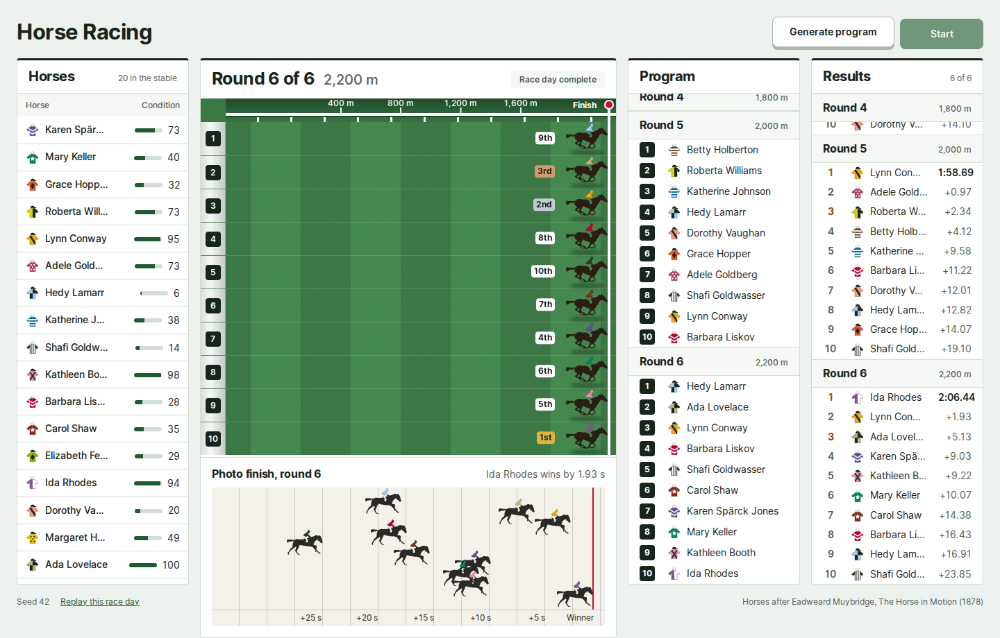

# Horse Racing

An interactive horse racing game built with **Vue 3, TypeScript and Pinia**: generate a
race program, start it, and watch six rounds run one after another, with results arriving
as each round finishes.

**Live demo:** https://huseyiniriss.github.io/insider-horse-racing/



## Features

- **20 horses**, each with a unique color worn as racing **silks**, and a condition of 1–100.
- **Generate program:** six rounds (1200 → 2200 m), ten horses drawn at random per round.
- **Start / Pause / Resume:** rounds run one at a time; pause freezes every horse exactly
  where it is.
- **Results** per round, racecard style: the winner's time, then the gap for everyone behind.
- **Animated horses** traced from Eadweard Muybridge's _The Horse in Motion_ (1878), in a
  broadcast-style racecourse with starting stalls, distance markers and a winning post.
- **Photo finish** after every round, built from the same finish times as the result.
- **Replayable:** one seed reproduces a whole session; the footer links the program on
  screen (`?seed=42&program=3`).
- Responsive (phone, tablet, desktop), keyboard accessible, screen-reader announcements,
  reduced-motion support.

## Quick start

Requires Node 22 (see `.nvmrc`).

```sh
npm ci
npm run dev          # http://localhost:5173
```

| Script                              | What it does                                            |
| ----------------------------------- | ------------------------------------------------------- |
| `npm run dev`                       | Development server                                      |
| `npm run build`                     | Type-check and production build                         |
| `npm run check`                     | Format check, lint, type-check and unit tests (CI gate) |
| `npm run test:unit`                 | Unit and component tests (Vitest)                       |
| `npm run test:coverage`             | Unit tests with coverage (enforced floor)               |
| `npm run test:e2e`                  | E2E and accessibility tests (Playwright)                |
| `npm run test:visual:docker`        | Visual regression tests in the CI Playwright image      |
| `npm run test:visual:update:docker` | Regenerate the visual baselines                         |
| `npm run sprites`                   | Rebuild the gallop sprites from the traced frames       |

Visual baselines are platform-specific, so they are generated and checked inside the
official Playwright Docker image (the same one CI uses). The `:docker` scripts need Docker.

## Architecture

```
src/
  app/          composition root: bootstraps stores from the URL seed, lays out the screen
  features/
    horses/     the stable: horse generation, silks, horses store, horse list, gallop figure
    race/       program, race engine, status machine, race store, clock, track and panels
  shared/       feature-agnostic: seeded random, ticker, formatters, tokens, UI primitives
```

- **Feature-based structure with enforced boundaries.** A feature is used only through
  its `index.ts`; `domain/` code is framework-free; `shared/` never imports features.
  ESLint fails the build otherwise.
- **The race is decided up front, then played back.** When a round starts, the engine
  gives every horse a pace per track segment (condition, form and luck). Finishing order
  and the position at any moment are pure functions of time, so what you see is the
  result, at any frame rate, and pause/resume is exact.
- **Explicit status machine** (`idle → ready → running ⇄ paused → finished`) drives both
  the store actions and the buttons. Generate is disabled while a race is in progress.
- **One clock.** A `requestAnimationFrame` ticker advances one piece of state per frame;
  horses move by CSS transforms.

The reasoning, alternatives and trade-offs are in the
[architecture decision records](docs/decisions/README.md); the visual language is in the
[design system](docs/design-system.md).

## Testing

| Level     | Tool                          | Covers                                                          |
| --------- | ----------------------------- | --------------------------------------------------------------- |
| Unit      | Vitest                        | Rules of the brief, engine properties, status matrix, stores    |
| Component | Vitest + Vue Test Utils       | Controls, track, program, results, photo finish, announcer      |
| E2E       | Playwright (desktop + mobile) | Generate, start, pause/resume, full race day, replay, axe check |
| Visual    | Playwright screenshots        | Idle, ready, paused and finished states with a frozen clock     |

Tests named `rule: …` map one-to-one to the requirements in the brief. Everything runs
from a fixed seed, so results are deterministic.

## Assumptions

The brief leaves a few points open; these are the choices made:

1. The game always has 20 horses; "1–20" is the numbering of the list.
2. Condition makes a horse faster on average, but form and luck still matter: a much
   fitter horse almost always wins, a slightly fitter one only more often.
3. Condition stays the same for the whole session.
4. A horse can run in several rounds; each round draws 10 of the 20 independently.
5. Generate is disabled while a race is running or paused, so a click cannot wipe a race
   in progress.

## Credits

- Horse figures traced from Eadweard Muybridge, _The Horse in Motion_ (1878), public domain.
- Typeface: [Open Runde](https://github.com/lauridskern/open-runde), SIL Open Font License.
- Horse colors: Kenneth Kelly's 22 colors of maximum contrast (1965), without white and black.
- Horse names: pioneers of computing, following the example in the brief.
